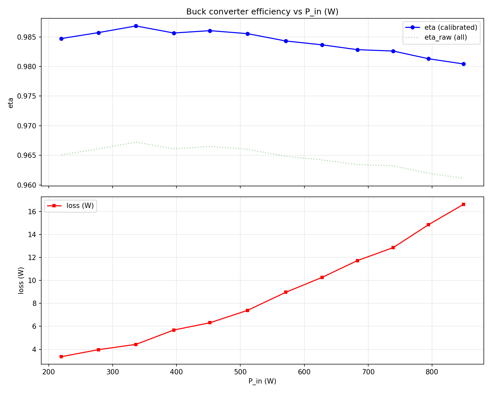

# flu

As-built config (parts, gate drive, Cin, coil): [dcdc-tools `loss/examples/flu.yaml`](https://github.com/fl4p/dcdc-tools/blob/main/loss/examples/flu.yaml)

FETs:
- HS: 2x IPP050N10NF2S at Q1, Q3 (TO-220, metal tab = drain = Solar+)
- LS: 1x IPP022N12NM6 in the D9 land, gate wired to Q2.1; Q2 empty

Gate drive:
- HS on: R4/R6 4.7Ω
- HS off: R5/R7/D1 not fitted
- LS: R10 4.7Ω

coil:
1s KDM-K184-125 3strands 1.8mm
* 17 turns
* 2.76mΩ (DMM6500 4W)
* L0=83µH

Caps:
- Input:
  - 1x rubycon ZLH 470u 100v
  - 1x ChemiCon KZE 560uF
  - 1x ChemiCon KZE 680uF

Heat sink: 100x100x18mm aluminium 

## 2026-10-11: Q3 screw short, ESP32 dead

- About 20:16, while seating an HS-tab TMP117, the Q3 (HS) mounting screw touched copper on
  the front side. Vin was about 70 V from a bench PSU with a 1.1 A current limit.
- Result: ESP32 dead, and D1-A is shorted to GND (D1/R5/R7 are not fitted). With Vin on,
  housekeeping draws about 2 W into the fault. Gate driver U1 was dead too.
- 2026-10-12, USB only: the S3 at MAC 18:8b:0e:fb:40:78 enumerates, and esptool connects. The
  module reports 2 MB embedded PSRAM (the schematic lists WROOM-1-N4). Flash ID is 0x5e/0x4016
  (4 MB), but it reads all 0xFF at 0x0, 0x8000 and 0x10000. The ROM loops on
  `invalid header: 0xffffffff` with TG0WDT resets.
- Board: Fugu2 pcbway-order-2024-10.
- Cause: the screw is at Solar+ through the metal tab. On the front side, the screw head
  covers U1's input-side pads, measured from the hole centre:
  - U1.4 GNDI: 2.60 mm
  - U1.5 DIS/SD (= GPIO47): 2.72 mm
  - U1.3 VCCI (+3.3V): 2.84 mm
  - R1 (DT/GND): 2.8–3.0 mm
  - C2 (+3.3V/GND): 3.1 mm

  An M3 head has about a 2.75 mm radius and a washer about 3.5 mm, so it reaches all of these.
  Which pad was actually hit has not been confirmed. Look for a mask scratch or burn mark.
- 1.1 A is far beyond what any pin clamp can take. DZ1 (SM2T3V3A, 3.3 V TVS) is not fitted on
  flu, so nothing clamped the 3.3 V rail.
- Before Vin goes back on: replace the ESP32, fit DZ1 and inspect the 3.3 V rail.
- To check or replace: U2 ESP32, U1 (replace even if it still switches), the D1-A short, R1, C2, and the rest of the +3.3V rail (U5 AP3012, U6 AS333, U7, U8, D2 WS2812B).
- Mitigation: insulate the Q1 and Q3 screws with a shoulder washer under the head. Next layout:
  move U1 out from under the screw head and keep copper at least about 4 mm from the hole
  centre on both layers.