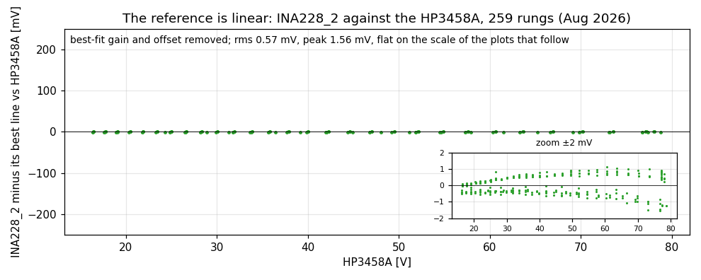
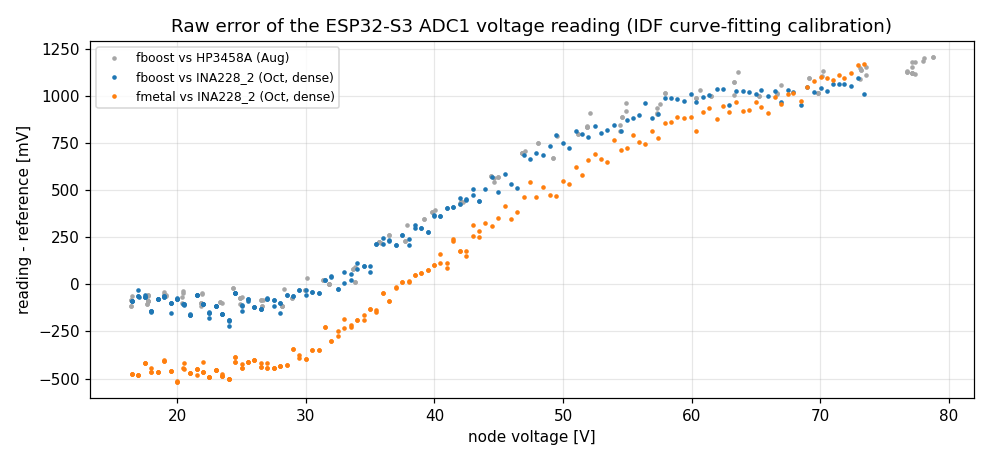
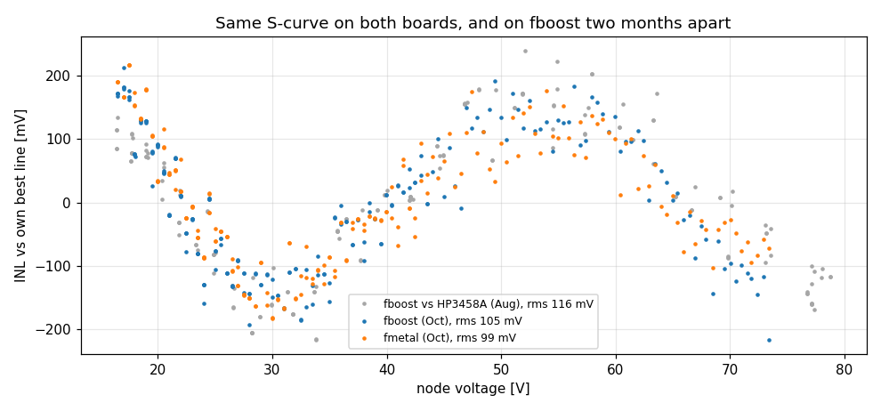
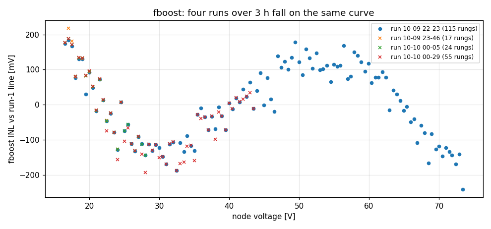
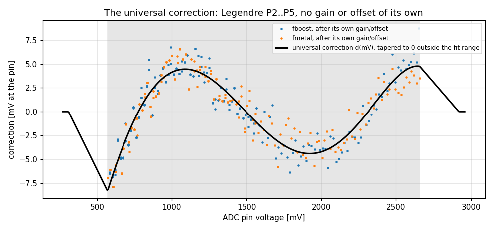
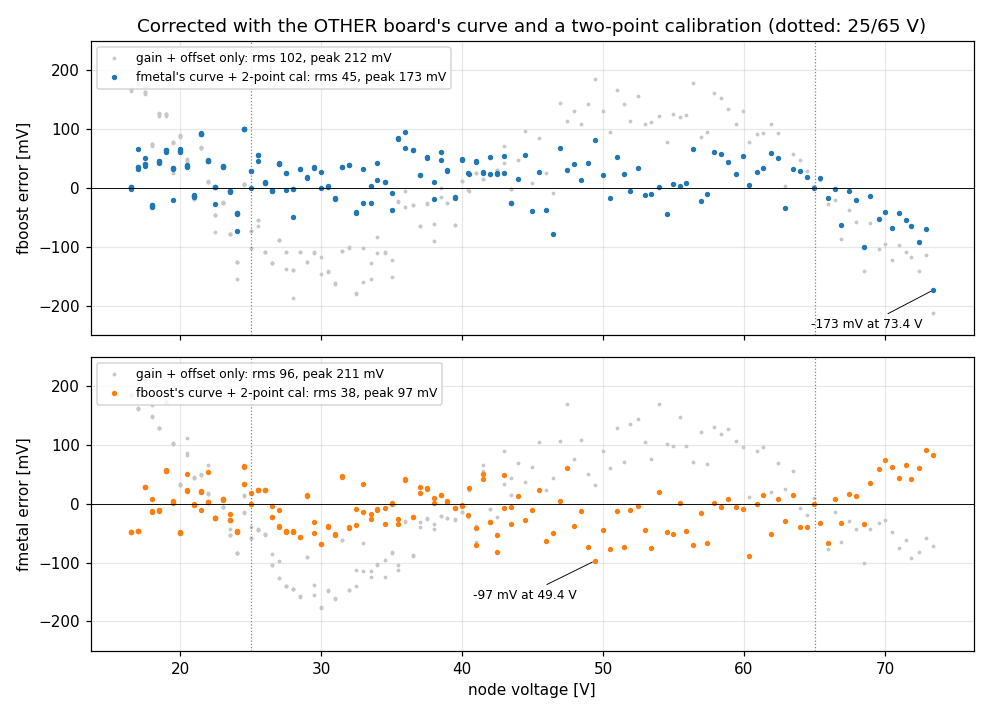
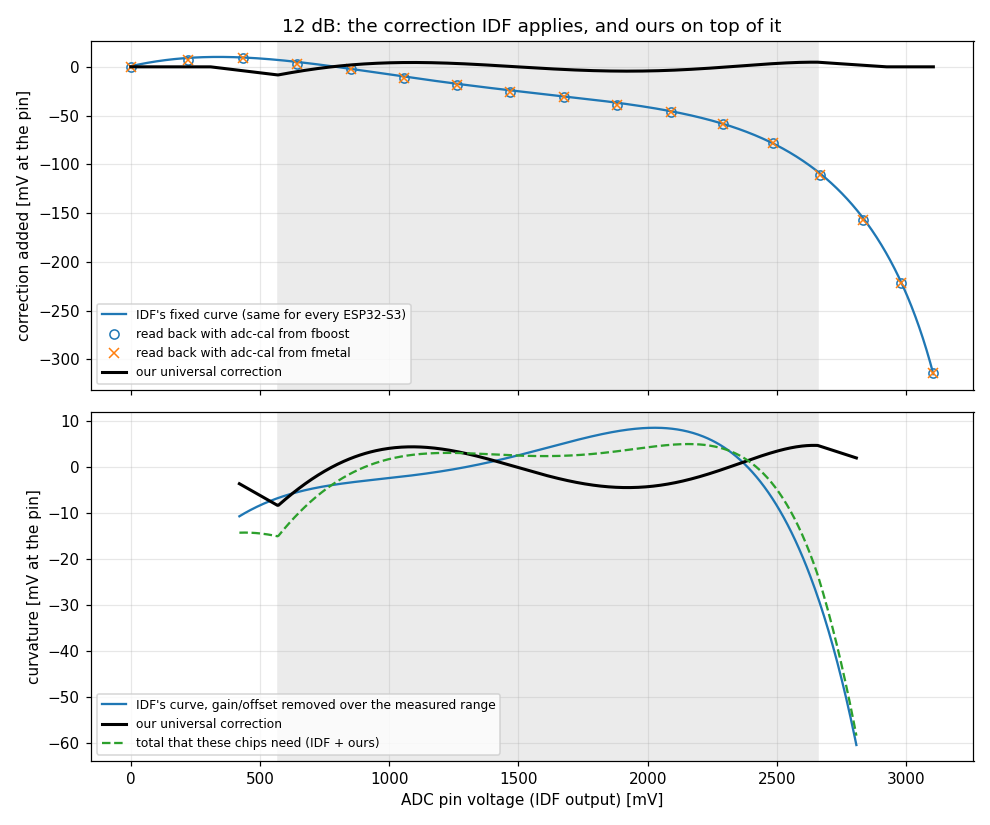

# Calibrating the ESP32-S3 ADC on the Fugu converters

The Fugu boards read their high-voltage side (up to ~80 V) through a 200k/7.5k divider into
ESP32-S3 ADC1 ch3, converted with ESP-IDF's curve-fitting calibration. Two of them, `fboost` and
`fmetal`, were measured on the same node against an HP3458A-traced reference from 16.5 to 73.4 V.

The ADC has a ±0.2 V S-curve, input-referred, on top of a gain and offset that differ per board.
The S-curve has a similar shape on both chips, and on one of them in August and October. One fixed
correction curve plus a two-point gain/offset calibration per board brings the error from
~100 mV rms to ~40 mV rms, that is, from ~0.25 % to ~0.1 % at 40 V. The correction ships in the
firmware as an opt-in (`esp32adc1_inl`).

The table compares each method's error against the reference:

| Board error vs reference | rms | max |
|---|---|---|
| IDF calibration, best per-board gain/offset (the existing linear model) | 96–102 mV | 212 mV |
| Universal curve from the other board, 2-point cal at 25 V and 65 V | **38–45 mV** | 97–173 mV |
| Board's own degree-5 fit (best case, for comparison) | 33–35 mV | 80–98 mV |

## Setup

- Node: the output of `fboost`, driven up a ladder of duty-cycle rungs from a Korad supply (10 V,
  0.75 A). Plan `ina228-u-4ref-dense`: 0.5 V rungs from 16.5 to 77 V, 30 s per rung.
- Devices under test: `fboost` (`Uo`, sent as BLE advertisements, float16, ~2 Hz) and `fmetal`
  (`Uo`, WiFi line protocol, 10 mV resolution, ~25 Hz). Both are configured as boosts, so the node
  is their HV side: ESP32 ADC1 ch3 behind 200k/7.5k (`hv_v_*` keys; `vout_*` at the time of the
  runs). `fmetal` hangs on the node and is powered by it.
- Reference: `BLE_ESP32_INA228_2`. A rung's value is the median of each device's readings
  over the rung window, so a rare garbage BLE packet cannot shift it.
- Data: four dense runs, 2026-10-09/10 (211 rungs for fboost, 201 for fmetal). Run 1 covered
  16.5–73.4 V. The others were cut short when the reference board dropped off BLE, see
  pwr-metering `doc/friction/20261010-supply-guard-s-3-poll-blind-tolerance-3-s-lets-one-27-s-ina2.md`.
  The August `ina228-U-2+3` runs add fboost against the HP3458A directly (166 rungs).

## Reference check



Over the same 16–79 V, after removing its best-fit gain and offset, `INA228_2` deviates from the
HP3458A by 0.57 mV rms (1.6 mV peak) over 259 rungs. That residual non-linearity is about 200×
smaller than the effect below, so the rest of this article treats the INA228 as the true value.
This is a linearity statement: the INA228's own gain and offset error (up to ~7 mV here) is
absorbed into each board's gain and offset.

## Raw error



With IDF's calibration and the nominal divider, both boards read 2.6–3.5 % high in gain, with an
offset of −0.7 to −1.3 V. Uncalibrated, they are off by −0.5 to +1.2 V across the range. That
part is ordinary gain/offset. Both chips carry the same factory gain point (see
[What IDF's calibration does](#what-idfs-calibration-does)), so IDF converts them with the same
gain; the measured difference between the boards comes from the divider and its loading, or from
chip differences the single factory point does not capture. These measurements cannot separate
the two. A per-board linear calibration removes it, and
`sensor.conf` could already express that through the divider values.

## Residual S-curve



After subtracting each series' own best line, an S-curve remains: +180 mV at 17 V, −150 mV around 30 V,
+130 mV around 50–58 V, −130 mV above 70 V (~100 mV rms, ~215 mV peak). A linear calibration
cannot remove it. It is worth correcting in firmware because it has:

- A similar shape on both boards. fboost and fmetal are different chips on different PCBs.
- A similar shape two months apart. The grey points are fboost against the HP3458A in August, the
  blue ones fboost against the INA228 in October.
- The same shape across runs, where they overlap:



Runs taken over three hours fall on the same curve. The later runs were cut short, so this
holds for 16.5–43.5 V; above that only run 1 exists. A degree-5 fit leaves 33–35 mV rms, and
that rung-to-rung scatter repeats too: comparing run 1 and run 5 rung by rung over their 55
common rungs, it correlates at 0.89. So it is not random noise. The likely cause is an
operating-point effect, fixed for a given duty and voltage (a hypothesis, not tested here). It
does not follow a smooth function of voltage and differs between the boards, so a shared smooth
correction leaves it in place. It sets the ~35 mV floor of the results below.

## The correction



The fit works in the ADC's own coordinates, pin millivolts, so the result does not depend on
the divider:

```
U_true / k  =  g_b · ( a + d(a) )  +  o_b
```

- `a`: the pin voltage as reported by IDF (not an independently measured pin voltage).
- `k = 28.07`: the divider, including the ADC's 500 kΩ load.
- `g_b`, `o_b`: the gain and offset of board `b`.
- `d`: the shared correction, built from Legendre polynomials P2..P5 only, on the fitted range
  normalized to −1..1. P0 and P1 are left out, so `d` has no offset or gain term in that basis
  and every board's gain/offset stays in its own `g_b`, `o_b`. (Against the actual, unevenly
  spaced rungs a straight-line fit to `d` is not exactly zero, but the board terms absorb it.)

The fit is a joint least-squares fit over both boards' rungs. The curve spans −8.3 to +4.8 mV at
the pin. There is no data outside the fitted 570–2658 mV (IDF readings), so the firmware fades the edge value to
zero over 261 mV, and an unmeasured range reads as it did before the correction.

To check that the curve transfers, the test fits it on one board only and applies it to the other. That board
gets only a gain and offset from two rungs, at 25 V and 65 V, as a production calibration would:



| Board | Line only (rms / max) | Other board's curve + 2-point cal (rms / max) |
|---|---|---|
| fmetal | 96 / 211 mV | **38 / 97 mV** |
| fboost | 102 / 212 mV | **45 / 173 mV** |

fboost's worst point is −173 mV at 73.4 V, the top rung, where fmetal's curve has the least
data; the next largest is about +100 mV near 24.5 V. The curve fitted on both boards, which is
what the firmware ships, brings fboost's maximum to about 108 mV.

## What IDF's calibration does

ESP-IDF's curve-fitting scheme (`esp_adc/adc_cali_curve_fitting.c`) converts a raw code in two
steps:

1. A straight line through zero, from one factory point burnt into eFuse per attenuation: the raw
   code the chip read at 850 mV. This sets the chip's gain. The offset is not in this step; the
   ADC driver loads a separate eFuse offset code into the hardware.
2. A fixed degree-4 curve in millivolts, subtracted from the result. Its coefficients are in IDF's
   source (`esp32s3/curve_fitting_coefficients.c`) and are the same for every ESP32-S3.

The firmware's `adc-cal` console command reads both from a running chip: the eFuse values per
attenuation, and IDF's conversion every 256 codes split into the step-1 line and the step-2 curve
(data in `esp32-adc/data/adc-cal-*.txt`). At 12 dB the two chips match exactly: both read code 1019
at 850 mV (834.15 µV per code), and only the hardware offset code differs (2241 vs 2232). At the
other attenuations the factory points differ by 1–2 codes. The step-2 curve read back from both
chips matches the polynomial in IDF's source to within 2 mV when both are evaluated at the same
step-1 value; the residue is IDF's integer arithmetic.



The read-back points span +9 to −314 mV between 0 and 3102 mV (top). Most of that is gain and
offset. The bottom panel removes a least-squares straight line from IDF's curve over the fitted
range only (a choice of convention: the line is fitted against IDF output, so the numbers shift by
about 1 mV with other weightings). What is left is IDF's bend, −28 to +9 mV. Our correction adds
−8 to +5 mV, mostly against that bend: up where IDF bends down below 1300 mV, down where it
bulges near 2000 mV. The sum is −24 to +5 mV. So through the middle of the range our measured
correction partly cancels IDF's bend: for these two boards, IDF's family-average curve bends
too far there. The measurements cover the whole board path (divider, ADC input, chip), so they do
not show whether the bare chips differ from Espressif's average or the board adds a bend.

## Integer truncation in the old firmware path

Before this change, the ADC1 driver averaged 32 raw codes with integer division and converted
the result with `adc_cali_raw_to_voltage()`, which only accepts an integer code. Flooring drops
0.37 mV at the pin, or ~10 mV input-referred, and adds a staircase of one code (~21 mV
input-referred). The firmware now builds a 65-knot float table of the IDF conversion at start-up
and interpolates the fractional average. IDF's own integer arithmetic stays in; a simulation puts
its effect at about −1.2 mV, nearly constant, which a board's offset absorbs.

The fit uses readings taken with the old path, shifted by the +0.37 mV the new path adds. The
shift moves the curve by less than 0.05 mV and matters only for the per-board offsets (~14 mV).

## Firmware

Merged into fugu-mppt-firmware `main` (`eb8f6a1`, together with the HV/LV side-key change).
fboost and fmetal run it as `fry-brk1-375-geb8f6a14`, with `esp32adc1_inl=1`.

- `src/adc/adc_esp32_cont.cpp`:
  - `buildMvTable()` and `rawToMv()`: the fractional conversion.
  - `inlDelta()`: the six coefficients, scaled to `x = (mV − 1614) / 1044` so float32 stays exact,
    then a Horner loop of five multiply-adds and the taper.
- `sensor.conf`:
  - `esp32adc1_inl` (default `0`): applies the correction at 12 dB on ESP32-S3, to every ADC1
    channel.
  - `<hv_v|lv_v>_gain` / `_offset`: per-board, as `V = gain · V_div + offset`. Keys are named by
    converter side; on these boost boards the node is the HV side, so `hv_v_gain`/`hv_v_offset`.

Cost: about 0.5 kB of code and 260 B of RAM. The table build runs once (~4k IDF calls) and
is skipped when `resetPeripherals()` re-enters `start()`. Per sample, the new path is cheaper
than the IDF call it replaces.

The correction is opt-in because turning it on shifts a deployed board's reading by up to ±0.23 V.
A boost regulating its output at 54 V, for example, would end up 0.12 V higher. Turn it on only
together with that board's gain and offset.

### Calibrate a board

To calibrate a board:

1. Set `esp32adc1_inl=1` and run the new firmware.
2. Hold the node at two voltages, about 25 V and 65 V, against a trusted reference. Two rungs
   of a plan like `ina228-u-4ref-dense` are enough.
3. Fit `gain` and `offset` from the two points and write `hv_v_gain` / `hv_v_offset` (or the
   `lv_v_` keys if the ADC1 channel is on the LV side).

Measured on the new firmware with the correction on (2026-10-10): 60 s holds at 25 V and 65 V via
the converter's own voltage regulation, medians against `BLE_ESP32_INA228_2`; a 45 V hold as the
check point; written to both boards and verified after a restart at 35 V and 55 V.

| Board | `hv_v_gain` | `hv_v_offset` | 45 V check | 35 / 55 V after restart |
|---|---|---|---|---|
| fboost | 0.973903 | +0.6714 V | −0.9 mV | −24 / +21 mV |
| fmetal | 0.969058 | +1.1123 V | −20.3 mV | −14 / −39 mV |

fboost regulated its own reading to each setpoint, and its telemetry is float16 (31 mV steps at
32–64 V, 62 mV above 64 V), so its 65 V point carries up to about ±30 mV of rounding. fmetal
reports 10 mV steps, about 3300 readings per window. The fit on the old firmware's data
predicted fboost 0.973991 / +0.680 V and fmetal 0.967109 / +1.182 V.

Full-range check with these values (2026-10-10, run `2026-10-10T14-55-18Z`): 2 V rungs from
16.5 to 77 V, up then down, 30 s each, medians against `BLE_ESP32_INA228_2`
(`esp32-adc/data/check.csv`):

| Board | 16.5–73.4 V (rms / max, n=58) | mean | 73.4–77 V (rms / max, n=5) | up − down (sd) |
|---|---|---|---|---|
| fboost | **40 / 85 mV** | −16 mV | 102 / 157 mV | 12 mV |
| fmetal | **41 / 90 mV** | −5 mV | 118 / 135 mV | 11 mV |

Inside the fitted range the boards land at the ~40 mV rms the offline fit predicted. The error
pattern repeats between the up and down passes to about 12 mV, so most of the 40 mV is the
repeatable residual, not noise. Above 73.4 V the correction fades out and the two boards drift
apart in opposite directions (fboost −95 mV, fmetal +135 mV at 76.5 V).

## Limits and open questions

- Only two chips, both measured the same way: each board has its own 200k/7.5k divider into ch3.
  With the same channel and the same divider values on both, the data cannot yet tell an ADC
  property apart from a source-impedance effect, or from two chips that happen to match. A third
  board, ideally on another channel or with different divider values, would settle it.
- Attenuation: everything here is at 12 dB, the attenuation these dividers need. IDF's curve and
  the factory points differ at the other attenuations, and the correction is not applied there.
- Range: 16.5–73.4 V at the node, 570–2658 mV as read by IDF. Below and
  above that range, the correction fades out. Below was not measured; above, the check run
  reached 77 V with errors up to 157 mV (see "Calibrate a board").
- Other channels: the correction applies to NTC and to current channels on ADC1 as well.
  For NTC that is a 0.06–0.4 K shift (estimate, unmeasured). For current channels it is untested.
- The ~35 mV floor (degree-5 residual) repeated between runs over 16.5–43.5 V. If it is an
  operating-point effect, removing it would take a correction indexed by operating point instead
  of voltage; that is untested.
- fboost's float16 telemetry quantizes at 31 mV between 32 and 64 V. With medians over
  30–60 readings per rung this adds a bias of at most half a step: small next to the floor, but
  not zero.

## Reproduce

```sh
# in pwr-metering (needs its influx access): per-rung data -> CSV
.venv/bin/python esp32-adc-extract.py ~/dev/ee/hw/Fugu2/doc/esp32-adc/data
# in Fugu2: figures, numbers and firmware coefficients, from the CSVs only
python3 doc/esp32-adc/plots.py
```

`plots.py` reads only the CSVs and prints the coefficients that go into `inlDelta()`.
