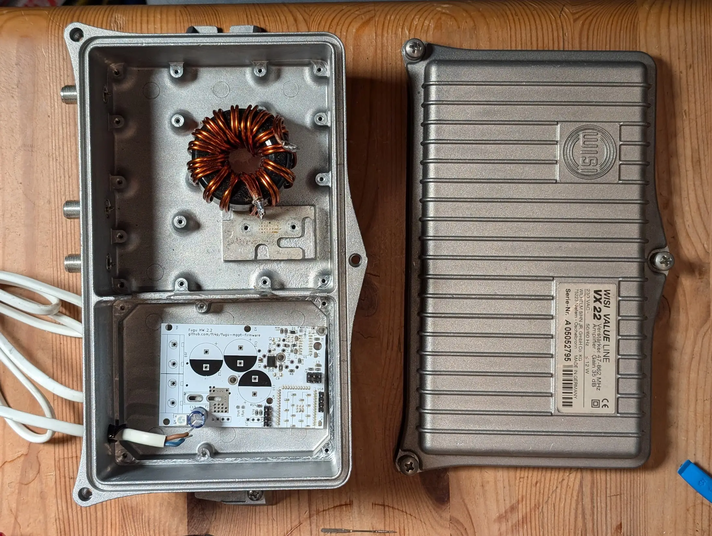
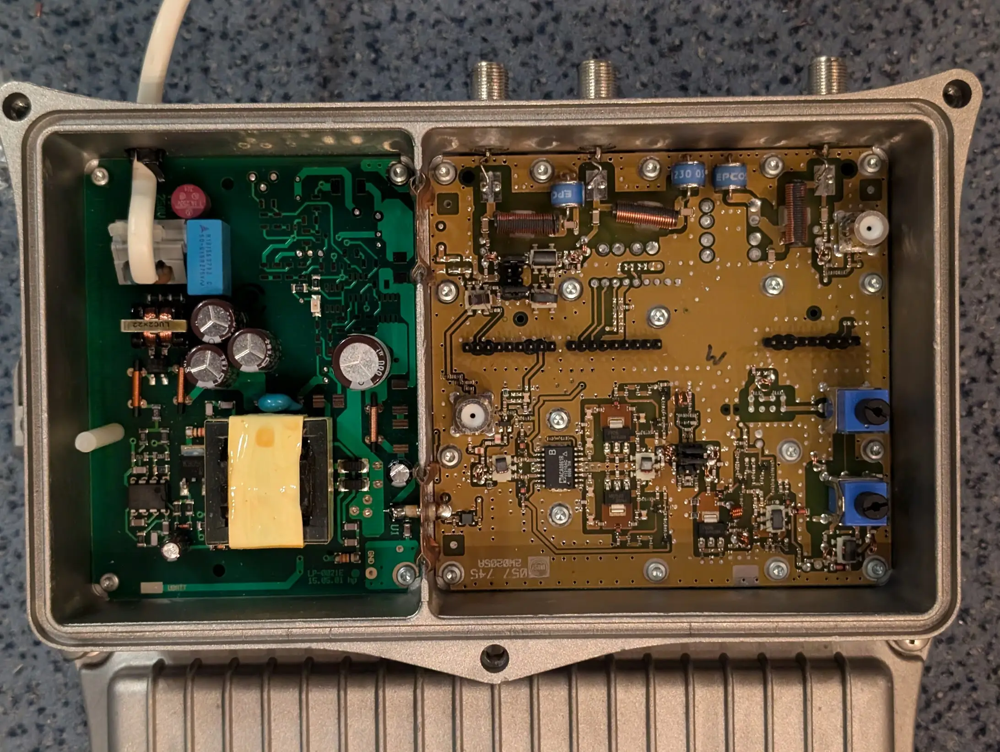

# Enclosures

Research compiled 2026-09-01; revised after an independent adversarial review (see
[Review history](#review-history)).

Scope: a housing for the Fugu2 board (**58.5 × 88.0 mm**, Edge.Cuts bbox from `Fugu2.kicad_pcb` since
`971ab77`, 2026-10-05; it was 50.0 × 88.0 mm when this note and the §7 shroud were made. The current
outline is not closed at the top-left corner, so treat the new width as provisional)
dissipating **~20 W** (`README.md`), currently screwed to an **AK-EL83-160** heatsink
(160 × 83 × 25 mm, `Thermal tests.md`).

Ratings from `README.md` § Specs: solar input **12–80 V**, battery output **12–60 V**, max output
current **32 A**. (27 V / 32 A is a *tested operating point*, not the rating.)

---

## 0. The constraint that shapes everything

From `Thermal tests.md`, under one shared condition block (Vin 61 V, Vout 26 V, ambient 24–25 °C,
AK-EL83-160, 2p TK6R8A08QM, 2× stacked T130 sendust):

| Condition | Average power | Heatsink equilibrium |
|---|---|---|
| Lying on wood (open air) | 760 W | 51 °C |
| In a cardboard box | 470 W | 61 °C |

38 % less throughput, 10 °C hotter. **Read this as a strong signal, not as a measurement of
enclosure capability**, because:

- The two runs are at *different* power levels, so this is not an equal-operating-point A/B.
- "Average power" is throughput, not dissipation. Loss is inferred via efficiency, not measured.
- No coil temperature was recorded, so "the coil limits the enclosed design" (below) is a
  hypothesis, not a result.

> **Working design rule: keep the finned face in free ambient air** — make the heatsink a *wall*
> of the enclosure rather than a component inside it.

**Caveat on the cardboard proxy.** Cardboard is a fair stand-in for an *insulating* (plastic) box.
It is a poor stand-in for a **metal** enclosure that is thermally bonded to the heatsink: such an
enclosure conducts and radiates from its whole outer surface and can plausibly *outperform*
cardboard. So the rule above is well supported for plastic and for any box that encloses the fins
in still air, and is **not** established for a bonded metal housing.

**What would settle it:** an equal-operating-point A/B — same Vin/Vout/Iout, measured input and
output power (loss by subtraction), and simultaneous coil, heatsink, enclosure-wall and ambient
temperatures logged to equilibrium.

Second-order concern the heatsink does not address: the toroid is described as running very hot
(`Thermal tests.md`), and inside a closed box its convective path off the windings is removed,
leaving only the 1.5–2 mm gap pad. Instrument the coil before assuming the FETs are the limit.

Meltdown run, quoting the source rather than paraphrasing it: Vin 75 V, Vout 27 V, Iout 32 A on a
10 × 10 cm heatsink — *"the HS melted at arround 00:28"*, output power was then adjusted manually
to hold 80 °C, *"which worked for 40minutes"*, after which temperature *"dropped, and increased"*.

---

## 1. Prior art in this project — repurposed CATV/SAT amplifier housings

`HW Stories/fisi.md` (now *fry*) already used an enclosure from a **WISI Value Line VX 22**
(Wilhelm Sihn jr. GmbH) with a Fugu HW 2.2 board. F-type connectors (SAT).

What these housings give you for free:

- Two-part **die-cast aluminium**, **cooling fins cast into the lid** — the heatsink-as-a-wall
  geometry, already solved.
- A **gasket groove** around the full perimeter, designed for outdoor pole mounting.
- **Separate RF-shielded compartments** with their own gasket grooves. On the VX 22 the coil sits
  in one and the board in the other — the partitioning a switching converter wants.
- Non-combustible enclosure material.
- Cheap and plentiful second-hand.

### The caveat

The VX 22 rating plate reads **`≤ 12 W`**. That is a **mains power-consumption rating, not an
enclosure thermal rating** — it comes with no stated permitted temperature rise, reference ambient,
mounting orientation or solar-load condition. For a CATV line amplifier essentially all of that
input becomes heat (RF output is negligible), so `20/12 = 1.67` is a fair **heat-input** comparison
— but the housing's actual dissipation capacity at a given wall temperature is **unqualified**.

**Action:** instrument a VX 22 build (TMP117 on the die-cast wall, plus coil) and run the
equal-operating-point A/B from §0 before committing. Do not treat 12 W as a hard ceiling *or* as a
green light.

Other housings in the same family worth scavenging: WISI VX/VS series, Astro, Axing, Kathrein line
amplifiers and outdoor multiswitches.

---

## 2. Fire and regulatory requirements

### Which regime applies

LVD **2014/35/EU Art. 1** applies to equipment "designed for use with a voltage rating of between
50 and 1 000 V for alternating current and **between 75 and 1 500 V for direct current**".

`README.md` rates the solar input **12–80 V**. The 80 V ceiling puts the product inside LVD scope
**if placed on the EU market** — CE marking, technical file, EU DoC. Building units for yourself
triggers none of it. (Reviewed and upheld: the input rating is the governing one; the lower output
voltage does not remove it, and no Annex II exclusion fits a PV charge controller.)

If every port were rated ≤ 72 V the product would fall below the DC floor and **the LVD
presumption-of-conformity route via EN IEC 62109-1 would disappear**. It would *not* simply "become
GPSR" — Regulation (EU) 2023/988 applies to consumer products or products foreseeably used by
consumers, and other EU legislation (EMC, RoHS, WEEE) continues to apply regardless. The practical
loss is the harmonised-standard route, not the existence of obligations.

The harmonised route for a PV charge controller is **EN IEC 62109-1**. Confirmed by example:
Victron's SmartSolar MPPT 100/30 & 100/50 datasheet declares exactly `EN/IEC 62109-1`.

### What 62109-1 asks of the enclosure

Clause structure reproduced from IECEE TRF `IEC62109_1B` as it appears in three published CB/TÜV
test reports. 9.1.3.1 and 9.1.3.2 come from the publicly visible parts of **TCVN 12231-1:2018**, which
declares itself *"hoàn toàn tương đương"* (fully equivalent) to IEC 62109-1:2010. The rest of that
text is behind a login, and the IEC original is paywalled.

| Clause | Requirement |
|---|---|
| 9.1.1 | Two alternatives. **Method 1** = fire enclosure. **Method 2** = material/component selection so ignition cannot propagate, no enclosure needed. |
| 9.1.2.1 | Components in **primary circuits** require a fire enclosure unless Method 2 is fully applied. |
| 9.1.3.1 | VTM-0/1/2 count as V-0/1/2. **Where HB or HBF is required, a material passing the IEC 60695-2-11 glow-wire test at 550 °C is accepted instead.** Parts that cannot be protected from overheating under fault must sit on V-1 material, ≥ 13 mm through air from anything below V-1 or behind a V-1 barrier. |
| 9.1.3.2 | **Fire-enclosure material: 5VB** (IEC 60695-11-20) at the thinnest significant wall, **or** pass the 5VB test as the finished enclosure. Either way: no drips or particles that ignite the cotton, no flaming > 1 min after the 5th flame application, no hole > 25 mm. Table 20 also lists a hot-wire test (IEC 60695-2-20) where the wall is < 13 mm through air from a part that can ignite. |
| 9.1.3.3 | Materials *outside* the fire enclosure: **class HB** minimum. |
| 9.1.3.4 | Materials *inside*: reports record "V-2 or better, or mounted on PCB rated V-0". |
| 9.1.4.3 | The **bottom** of a fire enclosure must stop flaming/molten material escaping beneath internal parts — this is what kills naive vent slots in the base. |
| 13.6.4 | Polymeric parts of an **outdoor** enclosure must resist UV degradation. |
| 13.7.3 | **7 J impact test** for polymeric enclosures (metal instead gets a 250 N deflection test, 13.7.2, plus thickness rules 13.8). |
| 14.6 | "Printed circuit boards shall be made of material with a flammability classification of V-1 of IEC 60707 or better." |

On 14.6: `Fugu2.kicad_pcb` records the laminate only as `"FR4"`, with **no UL flame class**. Common
FR-4 is V-0, but that is an assumption about your specific laminate, not a documented fact. Get the
flammability class from the fabricator or laminate datasheet before claiming this clause is met.

### UL 94 classes vs glow wire

Two unrelated test families exist:

| | **UL 94 family** | **Glow-wire family** |
|---|---|---|
| Standard | UL 94 / IEC 60695-11-10 (formerly IEC 60707) | IEC 60695-2-10…-13 |
| Stimulus | Gas burner flame, 10 s, twice | Nichrome loop at a set temperature, 30 s |
| Models | Open flame | Overheated joint / glowing component |
| Result | A **class**: HB → V-2 → V-1 → V-0 → 5VB → 5VA | A **temperature**: GWFI, GWIT, GWEPT |
| Home turf | Product standards like 62109-1 | IEC 60335-1 household appliances |

**What is solid:** the two produce different results and **cannot be converted into one another**
in general. A glow-wire figure establishes a flame class only where the standard says so. 62109-1
says so in exactly one place, at the bottom of the ladder: 9.1.3.1 accepts a 550 °C glow-wire pass
where **HB** is required. Nothing in the visible text lets glow wire stand in for V-x or 5VB. An
earlier revision said 62109-1 uses UL 94 classes and no glow wire. That was wrong at the HB level.

**What the source climb settled (2026-10-10):**

- **62109-1 does cite glow wire, in 9.1.3.1.** IEC 60695-2-11 is a normative reference (Annex ZA,
  SIST EN 62109-1:2011, iTeh free sample). The clause that uses it is 9.1.3.1, the HB substitution
  above, read in TCVN 12231-1:2018.
- **The `Glow-wire test (type test)` row the first review found is from IEC 62477-1, not 62109-1.**
  The isuna report's wording is "made under the conditions specified in 4.4.7.8.2 according to
  IEC 60695-2-10" and "Table A.1 of IEC 60695-2-11". That matches 62477-1 cl. 5.2.5.3 / 4.4.7.8.2,
  as read in JIS C 62477-1:2017 and in a public English 62477-1 test report. JIS C 62477-1 is a
  **MOD** adoption (IEC 62477-1:2012 + Amd 1:2016), not identical, so compare clause by clause. Only
  matching text links the row to 62477-1; the isuna PDF itself was never read. In 62477-1, glow wire
  (850 °C, or ≥ 550 °C per GWEPT, or the hot-wire alternative) applies to **insulating material
  touching live parts above DVC A_s**. That includes an enclosure part that does that job. For the
  fire enclosure, 4.6.3.2 accepts **5VA at the minimum thickness without test**, or the finished
  enclosure passing 5.2.5.5. Metal, ceramic and specified glass (heat-resistant, tempered, wired or
  laminated) are accepted without test.
- **Access record for the isuna report:** blocked at every rung. The rungs were curl, headless
  browser, headed scratch Chrome, and your own Chrome. The PEA WAF also blocks the site's home page
  from this connection, so this is an IP-level block, and it was not bypassed. The quotes above come
  from the search index (rung 6). **Waived by Fab on 2026-10-10**, so the report itself stays unread.

**Practical consequence when shopping, which is unaffected:** German/EU enclosure catalogues (Bopla,
Spelsberg, Fibox, Hensel) lead with glow-wire numbers like "GWFI 960 °C" because their volume market
is 60335-1 appliances. Ask additionally for the **UL 94 class at the actual wall thickness**; do not
accept a glow-wire figure as a substitute for a required flame class.

**For the fire-enclosure material itself, 62109-1 asks for 5VB** (9.1.3.2, table above), which is
already well above V-0. One certified small outdoor PV optimiser goes further and records
*"Flammability class 5VA plastic material used for fire enclosure"*. 62477-1 uses 5VA as its
no-test route.

> **What aluminium does and does not buy.** Metal removes the *enclosure material's* flammability
> and UV questions and swaps the 7 J impact test for a deflection test it passes easily. It does
> **not** remove: internal polymer requirements (9.1.3.4), fire-containment geometry and the
> bottom-opening rule (9.1.4.3), protective bonding of accessible metal, or the metal-specific
> mechanical and thickness tests (13.7.2, 13.8).

### You probably do not need IP65

Victron's comparable commercial MPPT is rated **IP43 (electronics) / IP22 (connection area)**, full
rated output only to 40 °C ambient, no cooling fan. A high IP rating and 20 W of dissipation fight
each other. Unless it lives outdoors unsheltered, splash-and-finger protection is the honest target
— and the VX 22 route in §1 gets a real outdoor seal anyway.

---

## 3. 3D printing

### The filament's rating is not your part's rating

UL Solutions, Blue Card FAQ, verbatim:

> "Unfortunately, due to the printing process, ratings from the Yellow Card do not carry over to the
> AM materials and have to be evaluated separately, with the specific printer and parameters."

And concretely: *"if a material obtains a V-0 rating with one model printer and a V-2 with a
different model printer, we would establish two Blue Cards"*. The rating is a property of
**material + printer + print parameters**, not of the spool.

The direction is not simply "printed is worse" — a 2024 study of a PP-based FR compound found
printed specimens outperformed compression-moulded ones. The rating is **unknown until
re-established for your process**.

### Temperature — screening data, not design limits

Measured sag-under-load, ramped convection oven (CNC Kitchen, Prusament samples):

| Filament | Starts to give | Fails |
|---|---|---|
| PLA | 60 °C | 65 °C |
| PETG | 80 °C | 85 °C |
| ASA | 110 °C | 120 °C |

**These are screening numbers from one loaded-jig ramp on specific prints — not HDT, not Vicat, and
not continuous-use ratings.** A real qualification needs the measured *part* temperature (not the
heatsink temperature), the actual stress and geometry, creep over time, and normal *and*
single-fault conditions. The 80 °C figure from §0 is a destructive test, not a normal condition.

With that said: the heatsink sits at 51–61 °C in normal operation. PLA begins to give at 60 °C, so
it has no usable margin anywhere near the heatsink, and PETG little. **ASA is the sensible floor**
for anything mechanically attached to it.

### FR filament landscape

| Filament | Claim | Basis | Status |
|---|---|---|---|
| Prusament ASA | none (nominally HB) | — | best non-FR choice |
| Polymaker PolyMax PC-FR | UL 94 V-0 @ 1.5 mm | TDS explicitly says *"Tested with 3D printed specimens"* | **discontinued** |
| Bambu PC FR | "Tested to meet the UL 94-2023 V-0 standard" | store page; no UL file or Blue Card number shown | self-declared |
| 3DXTech FireWire FR PC/ABS | "made using a premium UL94 V-0 rated PC-ABS" | rating attributed to the **feedstock resin** | read the wording |
| Formlabs Flame Retardant Resin | UL 94 V-0 | holds an actual **Blue Card** | properly certified (SLA, not FDM) |
| Prusament PETG V0 | UL 94 V-0 @ 0.75 / 3.0 mm | **Blue Card** E527425, Prusa printers only | certified filament, V-0 not 5VB |

Polymaker's TDS also warns the flame retardant *"significantly reduces the toughness of the raw PC
material"* — relevant to 13.7.3's 7 J impact test.

**Verdict:** printing the cover in ASA is reasonable for a personal build — keep it off hot
surfaces, use real wall thickness, accept it is uncertified. For a defensible fire story the honest
routes are a 5VB-capable material (see 9.1.3.2) or not making the fire enclosure out of plastic. A
Blue Card filament now exists, but only at V-0: **Prusament PETG V0**, UL file **E527425**,
"furnished as filaments", process "Material Extrusion". It is V-0 at 0.75 and 3.0 mm, with RTI
75 °C, and only for the listed Prusa printers (MK3S+, MK4/MK4S, XL, Core One) at fixed parameters
(0.4 mm nozzle, 0.2 mm layers). Its limits: V-0 is below the 5VB that 9.1.3.2 asks of a fire
enclosure, the P1P is not a listed printer, and PETG starts to sag at 80 °C (table above).

---

## 4. Off-the-shelf candidates

Dimensions from vendor tables read raw. Prices captured **2026-09-01**, single unit unless a break
is shown, read from live vendor pages. VAT basis differs by vendor. Ranking information, not quotes.

> **No candidate below is thermally qualified.** None of these vendors publishes a thermal
> resistance for these enclosures (checked for Fischer AKG: zero hits for `Wärmewiderstand` / `K/W`
> on both the product page and the distributor listing). Fin presence is a geometry fact, not a
> performance figure. Any 20 W claim needs vendor data or a controlled test.

Board is **88 × 58.5 mm** (was 88 × 50; see header). For slide-in extrusions the 88 mm side runs
along the enclosure **length**. All planar fits below hold for both widths.

| Candidate | External (mm) | Board capacity | Fins | Price |
|---|---|---|---|---|
| **Takachi AWA12-7-12SS** | 115.7 × 67 × 125.6 | internal 96.7 × 46 × 120.6 | both long sides | see note ▼ |
| **Takachi AWA15-8-16SS** | 152 × 77 × 160.6 | internal 133 × 56 × 155.6 | both long sides | — |
| **Hammond 1455NHD1601** | 160 × 111 × 60.76 | max PCB **159 × 97** | top face | **40,69 €** (elpro) · Mouser EU 48,33 @1 · 41,79 @5 · 39,35 @10 |
| **Hammond 1455KHD1601** | 160 × 86.02 × 51.02 | max PCB **159 × 74**, IP54 | top face | Mouser EU **45,80 €** @1 · 42,35 @5 · 41,14 @10 |
| **Fischer AKG 105 30 160 ME** | 105 × 30 × 160 | 100 mm eurocard guides | **none** (see ▼) | **29,81 €** @1 · 26,20 @5 · 24,35 @10 (Bürklin, ex-VAT) |
| **Fischer AKG 105 34/38/42 K** | 105 wide, H 34–42 | as above | **yes** — `K` = *mit Kühlrippen* | not priced |
| **Bopla Alubos ABPH** | ABPH 600–1680, L 100/150/200 | — | integrated, IP 65 | **68,69 €** ABPH 800-0200 (elpro) |
| Bopla Alubos ABP 800 (finless) | 82 × 32 × 200 | plan/height fit unverified | none | 37,75 € net / 44,92 € incl. (RS DE) |
| **Hammond 1590Z130** | 176 × 80 × 54 | — | none (diecast) | **37,59 €** @1 · 32,80 @5 · 30,63 @10 (Farnell DE, ex-VAT) |

**Corrections from review — read these before ordering:**

- **Hammond 1455KHD1601 *does* fit.** An earlier revision of this document rejected it by comparing
  the board's 88 mm side to the enclosure's 86.02 mm *external width*. That is the wrong axis:
  Hammond publishes **max PCB 159 × 74 mm** for the KHD, so an 88 × 58.5 mm board fits with 88 mm
  along the length. The NHD's published limit is **159 × 97 mm**. Both are planar fits; vertical
  clearance is still open (§6). The KHD is additionally listed **IP54**; Mouser's listing gives
  IP54 for the NHD as well. Mouser prices were read on eu.mouser.com on 2026-10-10 (NHD: 28 in
  stock; KHD: factory stock). The page does not say whether VAT is included.
- **`AKG 105 30 160 ME` is the unfinned variant.** In Fischer's numbering the `K` suffix means
  *mit Kühlrippen* — their `AKG 105 42 K` page reads *"Gehäuse **mit Kühlrippen** und ohne
  Befestigungslasche"*. The 29,81 € part carries no `K`. Order a `K` variant if you want fins.
- ▼ **The Takachi price is for `AWA12-7-9SS`** (the shorter 90.6 mm variant), US$ 60.40 @1 falling
  to 51.34 @100 at Misumi US. **`AWA12-7-12SS` itself is not priced here.** EU availability is the
  weak point — Farnell stocks the sibling AW/AWN/AWP lines, not AWA.
- **Bopla ABP 800 is 82 × 32 × 200 mm external**; its internal plan and height were not obtained, so
  its fit is *unverified* rather than "too narrow". **ABPH** is the finned profile — both Bopla
  catalogue pages titled *"mit Kühlkörper"* list only ABPH parts.
- **Fischer AKG** guides expect a 100 mm eurocard; mount the board on pillars instead.

### Hammond publishes thermal data

The 1455NHD/KHD pages link vendor thermal data, so these two are not unqualified like the rest:

- A worked calculation for the **1455NHD at 160 mm: R_sa = 1.58 °C/W**. It uses a flat-plate
  correlation at an assumed 0.25 m/s air speed (Hammond's "natural convection air speed") with an
  isothermal box. At 20 W that is ~32 K rise, before the correction below.
- R_th vs length charts for the **NHD and the KHD**. These are "determined under practical operating
  conditions", for vertical mounting and natural convection; **horizontal mounting adds 15 %**.
  Values have not been digitised here.

Both describe heat spread evenly into the box, not 20 W from one board on standoffs, so the §0 test
still decides.

### Estimated temperature rise, Fischer AKG 105 30 160 ME

Fischer publishes no Rth, so this is **calculated, not vendor data** — Simons flat-plate natural
convection (the method already cited in `Thermal.md`) plus radiation at ε = 0.8 for anodised
aluminium, iterated to convergence. Total external area 495 cm². Ambient 25 °C.

| Case | 15 W | 20 W |
|---|---|---|
| Free-standing, all six faces | ΔT 26 K → wall 51 °C | ΔT 34 K → 59 °C |
| **Sitting on a surface (realistic)** | **ΔT 34 K → wall 59 °C** | ΔT 43 K → 68 °C |
| Conservative k = 5.5 W/m²K design rule | ΔT 55 K → wall 80 °C | ΔT 74 K → 99 °C |

Emissivity sensitivity at 15 W on a surface: ε 0.8 → 34 K, ε 0.3 → 43 K, ε 0.05 (bare polished
aluminium) → 50 K. Radiation carries roughly a third of the load, so the anodising matters.

**These are wall temperatures, not junction or board temperatures.** Inside a sealed box the
air-to-wall coupling adds more rise unless the FETs bolt directly to the wall.

**Calibration against your own data:** AK-EL83-160 lying on wood, 760 W at ~98 % → ~15 W loss,
51 °C at 24–25 °C ambient = ΔT 26.5 K, so **Rth ≈ 1.75 K/W (estimated)**. Only the temperature and the
throughput were measured. The ~15 W loss comes from an assumed ~98 % efficiency, not a simultaneous
measurement, and all converter loss (coil included) is assumed to leave through the heatsink. The unfinned AKG estimate is
2.25 K/W at best — *worse than the heatsink you already own*. Model check: the same correlation
applied to the AK-EL83-160's bare base plate with no fin area gives 40.7 K vs 26.5 K measured with
fins, i.e. the fins are worth ~14 K. That is the right order, but it is a model compared with an
estimate, not a validation.

**Price summary:** cheapest aluminium box is the Fischer AKG at ~25–30 € (unfinned). Hammond 1455NHD
at ~41 € net is cheapest at elpro, but **elpro sells to businesses only** (its terms exclude
consumer contracts) and quotes net prices. Mouser EU also quotes ex-VAT (its sales terms: "Prices are
exclusive of taxes … value-added …") and sells to private buyers, at ~48 € for one. IP 65 *with* fins roughly doubles it (~69 €). The
outdoor-sealed diecast route is ~38 € plus the heatsink already owned. A scavenged VX 22 is likely
cheapest of all, but no market price was obtained.

---

## 5. Making the heatsink one wall

1. **Cover onto the existing heatsink.** The AK-EL83-160's 160 × 83 mm base becomes the floor; a
   U-profile or diecast box loses its own base plate and bolts down with a gasket in the joint.
   Cheapest, reuses owned hardware, fins unambiguously outside.
2. **Finned profile enclosure, board on standoffs.** Takachi AWA or Hammond 1455NHD/KHD. The
   extrusion's fins replace the separate heatsink and the FET pad couples to the finned wall.
   Cleanest result, but re-solves the thermal interface — and see the "not thermally qualified"
   note in §4.
3. **Diecast box, heatsink outside.** Hammond 1590Z, Bopla Bocube Alu, or a scavenged VX 22. Board
   inside, FETs bolted *through* the wall to the heatsink on the exterior. The only route reaching
   genuine IP68 while keeping fins in air, at the cost of a sealed through-wall thermal joint.

### The insulation system, not just the pad

`Assembly.md` notes the gap pad **is** the insulation, the heatsink is likely at PE, and the switch
node carries 75 V.

To be precise: **that pad is already a safety-relevant dual thermal/insulation interface today** —
making the heatsink a touchable enclosure wall raises the consequence of failure, it does not create
the hazard. Treating it properly means deciding a protection concept for the whole assembly, not
just specifying a film:

- **Class I** (accessible metal bonded to PE, pad provides basic insulation) **or Class II**
  (double/reinforced insulation, no reliance on PE) — pick one explicitly. The VX 22 in §1 carries
  the Class II square-in-square symbol, which is a hint about how that housing was conceived.
- Verified **protective bonding** of every accessible metal part if Class I.
- Creepage and clearance at the pad **edges**, and around semiconductor tabs and mounting fasteners
   — not just through-thickness dielectric strength.
- Rated withstand for **80 V plus transients**, verified by dielectric/impulse test (62109-1 cl. 7),
  not by the pad's W/m·K figure.
- Ageing: compression set, puncture by burrs or screw heads, and thermal cycling over life.

### Ventilation

62109-1 cl. 9.1.4 does permit openings in a fire enclosure, but the bottom rule (9.1.4.3) means
slots underneath the switching stage need a **baffle, not a hole**. Vent top and sides; keep a
solid, offset floor under anything that can drip.

---

## 6. Open questions

1. **Board stack height** — measure heatsink face to the highest point (almost certainly the top of
   the toroid winding). Every vertical-clearance judgement in §4 is provisional without it.
   Deliberately not estimated.
2. **Indoor/sheltered or genuinely outdoors?** Sheltered → Victron's IP43 territory. Outdoors → UV
   resistance for polymers, sealing, pressure compensation, and less thermal headroom.
3. **Thermal qualification of any chosen enclosure at 20 W.** Only Hammond publishes thermal data
   (§4), and it assumes heat spread evenly into the box.
   Needs the §0 equal-operating-point test.
4. **VX 22 capacity** — 12 W mains rating vs ~20 W dissipation (§1). Needs measurement.
5. **PCB laminate flammability class** — `Fugu2.kicad_pcb` records only `"FR4"` (§2).
6. ~~Where 62109-1 invokes glow wire~~. **Resolved 2026-10-10:** 9.1.3.1, as a 550 °C substitute
   where HB is required (§2).
7. ~~Fire-enclosure material class (9.1.3.2)~~. **Resolved 2026-10-10:** 5VB, or a 5VB test on the
   finished enclosure (§2), from the public portion of TCVN 12231-1:2018. The requirements for
   parts that fill openings in the fire enclosure are cut off behind the login; buy the standard if
   a plastic housing with a window or connector cut-outs goes ahead.

---

## 7. The printed shroud that was actually built — `3dmodel/`

A parametric ASA shroud now exists in [`../3dmodel/`](../3dmodel/): frame + lid over the
100 × 100 mm heatsink, which stays the floor with its fins outside, per §0. It is route 1 of §5
("cover onto the existing heatsink") reduced to a printed part.

Shape drivers, all taken from `Fugu2.kicad_pcb` rather than from a photo: Q1's TO-220 overhangs
the board by 7.08 mm and escapes through a slot in the bottom 6.5 mm of the left wall, so that
wall stays 2.5 mm off the board edge and the toroid keeps the widest strip of bare heatsink; the
ESP32 antenna overhangs by 5.69 mm and gets ≥3.3 mm of air in a bulged wall; the board sits ~2 mm
from the heatsink edge on that side, so the right and top walls hang alongside the heatsink and
bolt into its side faces instead of standing on it. Vents are above z = 12 only, aiming at cl. 9.1.4.3. That is a provisional design choice, not a
compliance rule. 9.1.4.2 counts side openings inside a 5° projection as bottom openings, and 9.1.4.1
applies everything in every intended mounting orientation.

**Open question #1 (board stack height) is still open** and now blocks a print rather than a
judgement: the model refuses to render until `standoff`, `stack_h`, `hs_gap_right`, `hs_gap_top`
and `hs_thk` are measured. See `3dmodel/README.md`.

`part="assembly"` also draws the real board, exported with `kicad-cli pcb export stl`. That is a
cross-check, not a gate — the export is not a closed mesh, and it has no model for the horizontal
TO-220s or the ATO fuses. It still earned its place: it showed the Würth terminal blocks reaching
4.4 mm further forward than their fab outline, which had left the lid edge 0.05 mm off them.

Two variants, both gated: `asbuilt` keeps the board where it is and closes the terminal end with a
6 mm sill; `shifted` moves the board 10 mm toward the terminal end so the terminals reach the
heatsink edge, drops the sill (no metal under it) and stands the USB-C end on a plinth instead of
a skirt. The left wall sits 0.2 mm off the board edge, with local pockets in its inner face for
the M3 heads at H1/H3/H4 — which reach 1.04 mm past the board edge — so the outer face stays flat.

Print orientation is baked in: both parts go on the bed **inverted**, which is the only pose where
either sits on a flat face. Sliced for a P1P in ASA that is 1 h 47 m and 41.8 g for both parts with
~1 cm³ of support — but note Bambu list ASA as *not compatible with the P1P*, which is an open-frame
machine; `3dmodel/README.md` carries that and the alternatives.

Unresolved on the bench: the toroid measures ~50 mm across in the build photos and the shroud
leaves a 44.8 mm strip beside it, so the coil has to move or overhang the heatsink edge.

**The shroud was dimensioned for the 50 mm board.** The outline is now 58.5 mm wide (header), so
re-check `3dmodel/` against the current Edge.Cuts before printing.

Unchanged by any of this: the insulation system of §5. A printed shroud neither creates nor
discharges it.

---

## Review history

- **2026-09-01, initial compilation.** Sources listed below.
- **2026-09-01, independent adversarial review** by an external model (`codex exec`), given the
  repo and nine numbered attack targets. Twelve findings returned; each was re-verified against
  primary sources before being applied. Accepted and fixed: the output rating (§ header), the
  meltdown paraphrase (§0), the cardboard-proxy overreach (§0), the VX 22 12 W inference (§1), the
  GPSR counterfactual (§2), the FR-4 V-0 assumption (§2), the "aluminium solves everything" claim
  (§2), sag-test framing (§3), **the Hammond KHD/NHD fit error (§4)**, missing thermal qualification
  (§4), the Takachi price attribution (§4), and the insulation-system discussion (§5). Downgraded
  rather than fixed: the glow-wire claim (§2), because the review's evidence was search-snippet
  level. Upheld
  under challenge: LVD scope via the input rating, the shared-condition-block arithmetic
  (38 %, 10 °C), UL 94 ↔ glow-wire non-convertibility, `20/12 = 1.67`, the Takachi AWA12-7-12SS
  plan fit, the transcription of the filament temperatures, and the price-summary arithmetic.
- **2026-10-10, source climb closed.** The review's glow-wire row was traced to IEC 62477-1
  (JIS C 62477-1:2017). IEC 60695-2-11 was confirmed as a 62109-1 normative reference (Annex ZA).
  The Hammond KHD/NHD prices were read on Mouser EU through Fab's Chrome. Details in §2 and §4.
- **2026-10-10, second independent review** (codex via the `codex-review` skill: network, scratch
  Chrome and Fab's Chrome). Nine findings, all checked against primary sources and accepted. The
  biggest: 62109-1 9.1.3.2 asks for **5VB** and 9.1.3.1 accepts **550 °C glow wire for HB**, both
  read in TCVN 12231-1:2018. The board outline grew to 58.5 mm wide. Hammond publishes thermal data.
  A Blue Card *filament* exists (Prusament PETG V0). JIS C 62477-1 is MOD, not IDT. The 1.75 K/W
  figure is an estimate. The z = 12 vent rule is provisional. elpro is business-only. Findings
  archived in `design/codex-review-enclosures-2026-10-10.md`.
- Found independently while answering a follow-up, not by the review: the Fischer `K` suffix
  (§4) and the absence of any published Fischer Rth.

## Sources

- Directive 2014/35/EU (LVD), CELEX:32014L0035 — Art. 1, Annex I.
- IEC 62109-1 clause text as reproduced in TRF `IEC62109_1B` in three published CB/TÜV reports
  (TÜV SÜD 70.409.19.175.01-00; Intertek 220201177SHA-001; report 6159006.50).
- SIST EN 62109-1:2011 free sample (iTeh), Annex ZA normative references.
- JIS C 62477-1:2017 (**MOD** IEC 62477-1:2012 + Amd 1:2016), kikakurui.com: cl. 4.4.7.8.2, 4.6.3.2, 5.2.5.3–5.2.5.5.
- Victron SmartSolar MPPT 100/30 & 100/50 datasheet — enclosure and standards blocks.
- UL Solutions, Blue Card / plastics-for-AM certification FAQ; UL Product iQ file E527425
  (Prusament PETG V0).
- TCVN 12231-1:2018 (≡ IEC 62109-1:2010), thuvienphapluat.vn, public portion: 9.1.3.1, 9.1.3.2,
  Table 20, normative references.
- Hammond 1455NHD thermal files: `thermal-transfer-coefficient.pdf`, `technical-introduction.pdf`,
  `1455nhd-`/`1455khd-r-value-vs-enclosure-length.pdf` (hammfg.com/files/products/1455nhd/).
- elpro standard business terms §§1, 3; Mouser EU sales terms (via search index; the page itself
  served a DataDome CAPTCHA).
- Polymaker PolyMax PC-FR TDS V3 and product wiki page.
- CNC Kitchen PLA/PETG/ASA comparison (measured, oven ramp under load).
- Vendor catalogues: Takachi, Hammond (incl. per-part max PCB size), Fischer Elektronik, Bopla.
- Distributor pages read live for pricing: elpro, Bürklin, Farnell DE, RS DE, Misumi US, Mouser EU.
- Simons, R., "Simplified Formula for Estimating Natural Convection Heat Transfer Coefficient on a
  Flat Plate", *Electronics Cooling*, Aug 2001 — via `Thermal.md`; used for the §4 estimate.
